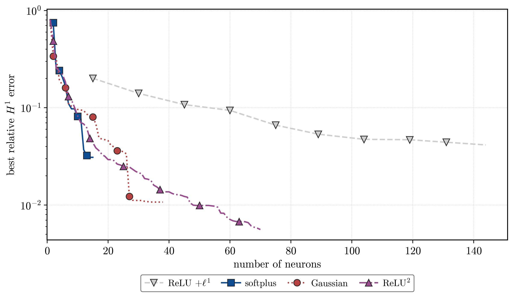

# Sparse neural networks for optimal feedback control

[](https://github.com/KeWu5678/sparse-nn-hjb/actions/workflows/ci.yml)

## The problem

Optimal feedback control has a classical answer: solve the
Hamilton–Jacobi–Bellman equation for the value function $V(x)$, and read the
optimal controller off its gradient — for the Van der Pol system,
$\hat u(x) = -\partial_{x_2}\hat V(x)/(2\eta)$.

Two things make that hard. $V$ is expensive to compute globally, and if it is
learned from data instead, **controller quality depends on $\nabla\hat V$, not on
$\hat V$**. A model with an excellent value fit and a mediocre gradient field
produces a controller that oscillates, saturates, or diverges. Most of the
engineering here follows from taking that second point seriously.

The approach: sample value *and* gradient data from open-loop solves via
Pontryagin's principle, then fit a shallow network
$\sum_k c_k\sigma(a_k\cdot x + b_k)$ under an $H^1$ loss, so the gradient is a
first-class training target. Width is not fixed in advance and sparsity is not
post-hoc pruning — neurons are inserted adaptively by a Primal–Dual Active
Point method over a measure-space formulation.

## Result

<p align="center">
  
</p>

Accuracy against width on Van der Pol. The displayed sparse nonconvex models
reach lower error with fewer neurons. The conventional ReLU + $\ell^1$ network
remains above these three nonconvex models at their selected operating points.
The plot uses $\alpha=10^{-6}$ for ReLU<sup>2</sup>; the table below uses
$\alpha=10^{-5}$ for both rectified powers.

Representative $H^1$-trained checkpoints, selected by minimum training
objective:

| activation | penalty | neurons | rel. $H^1$ error |
| --- | --- | ---: | ---: |
| softplus | normalized log penalty | **14** | 0.0311 |
| tanh | normalized log penalty | 29 | 0.0218 |
| Gaussian | normalized log penalty | 32 | **0.0111** |
| ReLU<sup>2</sup> | $\sum_i \lvert c_i\rvert^{2/3}$ | 39 | 0.0114 |
| ReLU<sup>3</sup> | $\sum_i \lvert c_i\rvert^{1/2}$ | 24 | 0.0140 |

The first three use $\alpha=10^{-4}$, $\gamma=10$, and $p=2.01$; the
fractional-power fits use $\alpha=10^{-5}$.

Errors are relative $H^1$ in original coordinates — the fitted $V$ and its
gradient with respect to the original state variables, after undoing the
training normalization.

Feedback rollouts from $y_0=(2,1)$ over the benchmark horizon $T=3$.
The ReLU<sup>3</sup> controller uses a separate $\alpha=10^{-6}$ checkpoint:

| controller | neurons | terminal state norm | running cost |
| --- | ---: | ---: | ---: |
| numerical open-loop reference | — | 0.3517 | 6.4010 |
| softplus | 14 | 0.2354 | 6.4191 |
| Gaussian | 32 | 0.2178 | 6.4249 |
| ReLU<sup>3</sup> | 30 | 0.1597 | 6.4487 |

The reference solves the finite-horizon PMP boundary-value problem with a free
terminal state and zero terminal cost. Each learned-controller cost is
accumulated along its own trajectory. All VDP state, control, and cost plots
use the same horizon $T=3$.

The pendulum benchmark tests value functions with gradient jumps. It compares
regional errors, alternative training-sample allocations, and feedback from
two initial states over $T=10$. All five selected nonconvex controllers reach
the upright neighbourhood from the easier start; only ReLU<sup>2</sup> does so
from the harder start. The ReLU–$\ell^1$ baseline also reaches it from both
starts. All training variants share an evaluation pool excluding their sample
states; model selection uses switching-region error on that pool.

## Engineering

**A semismooth Newton optimizer, written as a native PyTorch optimizer.** The
outer-weight problem is nonsmooth and nonconvex. `src/SSN/` is a
`torch.optim.Optimizer` subclass implementing a normal-map semismooth Newton
method with matrix-free CG for the Newton system and closed-form global proximal
maps for the fractional penalties $q\in\{1/2,\ 2/3,\ 1\}$. It follows the
`step(closure)` contract, one Newton iteration per step. PDAP runs the iteration
budget and discards a correction which increases the objective — the property
that keeps the outer loop monotone.

**Golden-output tests.** Refactors of the numerical core are checked against
stored reference solutions, not just unit assertions. A change in solver
behaviour shows up as a diff in neuron counts and errors, not as a silently
different answer. The suite runs in CI alongside `ruff`.

**MLflow is the system of record.** Every training job is one MLflow run holding
its resolved config, dataset hashes, errors in physical units, per-checkpoint
traces, and the fit as `history.pt`. Training refuses to start when the
tracking server is unreachable. The server is a container in [`deploy/`](deploy).

**Experiments are configs, not scripts.** Each study is one tracked Hydra file
declaring its own sweep axes and its own output layout, so a sweep is a single
command and the record tree is self-organizing:

```bash
make sweep EXPERIMENT=log_penalty        # 448 runs across two datasets
```

Hydra configs and logs land under
`rawdata/logs/multirun/<dataset>/<experiment>/<axis>/<job>/`. The target refuses
to start if that subtree already exists or the tracking server is unreachable.

**Reproducibility is checked, not assumed.** Runs are deterministic under a
fixed seed — re-running a completed configuration reproduces its metrics to
seven digits. Solver changes that move results are recorded as ADRs in
[`docs/adr/`](docs/adr) with an explicit instruction to re-run affected studies.

## Reproduce

```bash
scripts/init.sh                       # Python environment + local MLflow server (Docker)
make sweep EXPERIMENT=log_penalty     # `make help` lists the presets
```

Results appear in the dashboard at <http://127.0.0.1:5000>. Run the tests with
`uv run pytest`. Presets, datasets, and re-runs are described in
[experiments/README.md](experiments/README.md).

## Layout

| Path | Contents |
| --- | --- |
| `src/` | Library: shallow networks, `PDAP/` insertion, `SSN/` optimizer, data/eval/plotting |
| `conf/` | Hydra configs — model families, datasets, evaluation, experiment sweeps |
| `scripts/` | `train.py` entry point, dataset generators, `init.sh` |
| `experiments/` | Current workflows, reference-data plotters, and local paper outputs |
| `tests/` | pytest suite, including golden-output solver tests |
| `docs/` | ADRs, MLflow guide, research notes |
| `deploy/` | Containerized MLflow tracking server |

Hydra logs, figures, and reports are written to ignored local paths.
